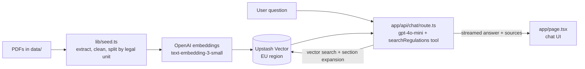

# EU & Norwegian Cyber and AI Regulation Assistant

A public retrieval-augmented (RAG) chat assistant that answers questions about **EU and Norwegian cybersecurity and AI regulation** (the Cyber Resilience Act, the AI Act and Norwegian digital security law), with a citation for every key point.

**Live app:** https://cra-dsa-compliance-assistant.vercel.app

Built for *Week 14 – Ship Your Own RAG, Graded Mini Project 14.3*, starting from the Week 14A Next.js RAG starter.

> **Disclaimer:** This assistant provides information, not legal advice. Always check the official text and confirm decisions with legal counsel or the relevant authority.

---

## What it does

- Answers questions in **English or Norwegian**, and replies in the language of the question
- Grounds every answer **only** in the source texts, and says so when the texts do not cover a question
- Cites provisions inline, for example `[CRA – Article 14]` or `[Digitalsikkerhetsforskriften – § 17]`
- Shows the retrieved sources under each answer, with a link to the official text
- Handles comparisons across laws, follow-up questions, and out-of-scope requests (for example NIS2: it declines, then points to the nearest in-scope provisions)

## Corpus

| Document | Language | Version | Chunks | Source |
|---|---|---|---|---|
| Cyber Resilience Act – Regulation (EU) 2024/2847 | English | Official Journal text published 20 November 2024 | 389 | [EUR-Lex](https://eur-lex.europa.eu/eli/reg/2024/2847/oj) |
| Commission Implementing Regulation (EU) 2025/2392 (important and critical products under the CRA) | English | Official Journal text published 1 December 2025 | 35 | [EUR-Lex](https://eur-lex.europa.eu/legal-content/en/TXT/?uri=CELEX:32025R2392) |
| AI Act – Regulation (EU) 2024/1689 | English | Consolidated text as of 27 July 2026 | 408 | [EUR-Lex](https://eur-lex.europa.eu/legal-content/EN/TXT/?uri=CELEX:02024R1689-20260727) |
| Digitalsikkerhetsloven (Norwegian Digital Security Act) | Norwegian | Lovdata text retrieved 26 September 2026 | 21 | [Lovdata](https://lovdata.no/dokument/NL/lov/2023-12-20-108?q=digitalsikkerhetsloven) |
| Digitalsikkerhetsforskriften (Norwegian Digital Security Regulation) | Norwegian | Lovdata text retrieved 26 September 2026 | 28 | [Lovdata](https://lovdata.no/dokument/SF/forskrift/2025-06-20-1131?q=digitalsikkerhetsforskriften) |
| Sikkerhetsloven (Norwegian National Security Act) | Norwegian | Lovdata text last amended 16 October 2026 (LOV-2026-06-23-74) | 74 | [Lovdata](https://lovdata.no/dokument/NL/lov/2018-06-01-24) |
| Virksomhetsikkerhetsforskriften (regulation on organisations' preventive security work) | Norwegian | Lovdata text last amended 3 May 2019 (FOR-2019-05-03-560) | 96 | [Lovdata](https://lovdata.no/dokument/SF/forskrift/2018-12-20-2053) |

The corpus produces **1,051 chunks**: from the CRA 130 recitals, 70 articles, the 51 definitions of Article 3 and 8 annexes; from the AI Act 118 articles (including inserted Articles 4a, 60a and 75a–75d), the 70 definitions of Article 3 and 14 annexes; from the implementing regulation 9 recitals, 2 definitions, 2 articles and 2 annexes; plus the § sections of the four Norwegian texts (sikkerhetsloven uses chapter-section numbering, `§ 1-2`). Lovdata's "Kort om loven" box, an encyclopedia summary rather than law text, is left out. Every chunk records the version of its text, which the assistant states in its answers: "consolidated text" only for EUR-Lex consolidated versions, "Official Journal text" for original acts, and for Lovdata texts Lovdata's "Sist endret" (last amended) field when the PDF has one, otherwise the date the text was retrieved.

Manual test questions with expected sources are in [docs/test-questions.md](docs/test-questions.md).

More sources are being added in batches (the digitalsikkerhetsloven preparatory works, NSM's basic principles for ICT security, and Commission, ENISA, EDPB and Datatilsynet guidance); their PDFs wait in `data-pending/`.

EU legislation on EUR-Lex may be reused with attribution (Commission Decision 2011/833/EU). Norwegian laws and regulations are not subject to copyright (åndsverkloven § 14). NIS2 and ISO standards are intentionally excluded: NIS2 is not yet in force in Norway, and ISO standards are copyrighted.

## How it works



1. **Ingestion (`lib/seed.ts`)** reads every PDF in `data/`, extracts text page by page, removes running headers, footers and EUR-Lex amendment markers, and splits each document into legal units: Recitals, Articles (including inserted ones such as Article 4a), single definitions (`Article 3(14a)`) and Annexes for EU acts, and § sections (`§ 6`, `§ 1-2`) for the Norwegian texts. Long sections are split into parts with overlap. Each chunk is prefixed with a citation header (for example `CRA – Article 14 (Reporting obligations of manufacturers)`) and stored with document, section, chapter (and section), page, source URL, source type, binding status, issuer, publication date and text version metadata. Documents are registered in `lib/sources.ts`.
2. **Retrieval as a tool call (`app/api/chat/route.ts`)**. The model decides when to call `searchRegulations`, which embeds the query and searches Upstash Vector, optionally filtered to one law.
3. **Section expansion**. If a top result is part of a split provision, the remaining parts of that provision are fetched as well, so the model sees the complete article or §.
4. **Streaming UI (`app/page.tsx`)** streams the answer, renders inline citation tags, and lists the retrieved sources with page numbers, match scores and links.

## Key design decisions

| Decision | Why | Trade-off |
|---|---|---|
| Split by legal unit instead of fixed windows | Chunks align with how the law is cited, and citations become precise | Requires document-specific parsing rules |
| Citation header inside each chunk | Improves retrieval and lets the model cite exactly | Slightly more tokens per chunk |
| Section expansion (all 6 results, up to 3 sections, max 10 parts each) | Long provisions such as CRA Article 14 are answered completely | More context per answer, so slightly higher cost and latency |
| Cross-lingual retrieval without translation | Norwegian originals remain the authoritative text | Relies on the multilingual quality of the embedding model |
| Optional document filter on the search tool | Better comparisons across laws | Unknown values are ignored rather than rejected, to avoid crashes |
| Small built-in formatter instead of a Markdown library | No extra dependency, never injects HTML, only https links | Supports a limited Markdown subset |
| Sources panel capped at 8, expandable | Keeps answers readable | Some sources are hidden until expanded |
| Rank 100 candidates, keep the best 6 | Upstash's approximate search missed all of the true top 6 for some short Norwegian queries (for example "varslingsplikt") at 6 and even 50 candidates; 100 was exact on every measured query | One extra fetch per search for the texts of the best 6 |
| Chapter line in each chunk ("Kapittel 2 – Sikkerhetsstyring") | Broad questions find every section of a chapter, even sections that never use its key term | A few more tokens per chunk |

## Model choice

**Deployed model: `gpt-6-luna` with reasoning off**, set in Vercel with `CHAT_MODEL=gpt-6-luna` and `CHAT_REASONING_EFFORT=none`. The code default is still `gpt-4o-mini`, which is also the rollback: remove both variables and redeploy.

The chat model was evaluated on the eight questions in [docs/test-questions.md](docs/test-questions.md) (tests 1–5 and 8 twice, tests 6 and 7 three times: 18 answers per model), with the same corpus, prompt and retrieval:

| Model | Content correct | Fully correct, incl. citation form | Avg tokens per answer (in / out) | Avg cost per answer |
|---|---|---|---|---|
| `gpt-4o-mini` | 13 of 18 | 11 of 18 | 8,093 / 278 | $0.0014 |
| `gpt-6-luna`, reasoning off | 17 of 18 | 16 of 18 | 17,191 / 378 | $0.0019 |

`gpt-4o-mini` attributed details to the wrong provision (a 24-hour deadline from digitalsikkerhetsforskriften § 17 cited to digitalsikkerhetsloven § 8 in all three NIS2 runs) and mixed in a section of a different regulation when asked about virksomhetsikkerhetsforskriften. `gpt-6-luna` cited correctly, but in one of three NIS2 runs it opened with NIS2 deadlines from its own knowledge before declining. Luna reads about twice as much context because it searches about twice per question, which its lower token price mostly offsets. Costs use $0.15 / $0.60 (gpt-4o-mini) and $0.10 / $0.50 (gpt-6-luna) per million input / output tokens; check them against OpenAI's current pricing.

Why Luna (17 of 18 answers with correct content, against 13 of 18): its one failure, an out-of-scope answer that partly drew on general knowledge before declining, is visible to the reader and concerns a law the assistant openly says it does not cover. `gpt-4o-mini`'s failures were wrong attributions, where a statement is cited to a provision that does not contain it. In a compliance tool that is the more serious risk, because the citation makes the error look verified. The cost increase is about $0.0005 per answer.

## Stretch goals

1. **Multi-PDF support**: all PDFs in `data/` are loaded, with document-specific titles, languages, source links and structure detection.
2. **Suggested-prompt chips**: the empty state offers four one-click questions and explains what the assistant knows.

## Tech stack

Next.js 15 · React 19 · Vercel AI SDK 4 · OpenAI (`gpt-6-luna` in production, `gpt-4o-mini` as code default and rollback, `text-embedding-3-small`) · Upstash Vector · Tailwind CSS · Vercel

## Run locally

**Prerequisites:** Node.js 20 or later, an OpenAI API key, and an Upstash Vector index with **1536 dimensions** and the **cosine** metric.

```bash
# 1. Install dependencies
npm install

# 2. Configure secrets (never commit this file)
cp .env.example .env.local
# fill in OPENAI_API_KEY, UPSTASH_VECTOR_REST_URL, UPSTASH_VECTOR_REST_TOKEN

# 3. Preview chunking without cost (writes seed-preview.json)
npm run seed -- --dry-run

# 4. Embed and upload (clears the index first)
npm run seed

# 5. Start the app
npm run dev
# open http://localhost:3000
```

To add a document, register it in `lib/sources.ts` (file name, citation name, type, language, dates, link and batch). The register is the single list used by the seed, the chat route and the UI. Then place the PDF in `data/`, raise `ACTIVE_BATCH` if needed, check the dry run and seed again. PDFs for later batches wait in `data-pending/`, which the seed does not read; preview them with `npm run seed -- --dry-run --dir=data-pending`.

The seed refuses to run if a PDF is not registered, if two PDFs are identical, if a live source is missing from `data/`, or if a later-batch PDF is in `data/`. Repeated text within a document is embedded only once.

## Deploy

The app is deployed on Vercel with automatic deployments from the `main` branch. Set `OPENAI_API_KEY`, `UPSTASH_VECTOR_REST_URL` and `UPSTASH_VECTOR_REST_TOKEN` under **Project → Settings → Environment Variables**. Seeding runs locally, and the deployed app reads from the same Upstash index.

## Security and privacy

- API keys are used only on the server (`route.ts`, `seed.ts`) and never use the `NEXT_PUBLIC_` prefix. The live site was checked to confirm no keys appear in the page source, JavaScript bundles or network traffic.
- `.env.local` and `seed-preview.json` are excluded from Git.
- Server errors are logged in Vercel, and users see only a generic error message.
- OpenAI usage is protected by a monthly spending limit.
- The vector index is hosted in an EU region.
- Retrieved source text is visible in the browser. That is acceptable for public legislation, but a confidential corpus would need authentication and access control.

## Limitations and next steps

- No rate limiting or authentication yet
- No formal evaluation harness; testing has been manual, with a documented set of demo and edge-case questions
- Exact references such as "§ 17" rely on semantic search; hybrid (keyword + vector) retrieval would make them more reliable
- Long annexes are split into fixed-size parts, and section expansion fetches at most 10 parts per section, so very long annexes (for example Annex I of Implementing Regulation 2025/2392, 17 parts) can be incomplete. Next step: split annexes by numbered category, as is already done for definitions, so each category is retrieved and cited on its own
- The corpus is a snapshot and needs a process for updates, including the CRA's EEA incorporation status in Norway
- Out-of-scope questions are occasionally answered partly from the model's general knowledge before declining (1 of 3 runs for NIS2 in testing). The prompt already asks for a fixed answer template (decline, related in-scope provisions with citations, version line). Next step: enforce the out-of-scope template in code, not only in the prompt
- Citation form is not fully consistent: the model occasionally combines sections in one tag (for example `[Digitalsikkerhetsloven – §§ 8, 11]`) or describes a referenced annex under the article that refers to it (Annex III under `[AI Act – Article 6]`). The content and the sources panel are still correct, so this is accepted as a known limitation.
- The chat model can be switched for evaluation with the server-side `CHAT_MODEL` and `CHAT_REASONING_EFFORT` variables (default `gpt-4o-mini`). With the installed AI SDK (`ai` 4.3, `@ai-sdk/openai` 1.3), gpt-6 models only work through Chat Completions with reasoning switched off (`CHAT_REASONING_EFFORT=none`), which `gpt-6-luna` accepts. `gpt-6.1-sol` requires reasoning, and therefore the Responses API for tool calls, where SDK 1.3 sends a `temperature` the model rejects. Next step: upgrade the AI SDK (a major-version migration of the chat route and the `useChat` tool-call handling in the UI) before evaluating `gpt-6.1-sol`
- Seeding clears and rebuilds the shared index, so the live app sees an empty or partial index for the short time the upload takes. A fix is to seed into a new Upstash namespace and switch the chat route to it with an environment variable once the upload has finished (blue/green), then delete the old namespace

## Project structure

```
app/
├── api/chat/route.ts   # RAG-as-tool-call route with section expansion
├── layout.tsx          # page metadata
└── page.tsx            # chat UI, empty state, sources panel
data/                   # source PDFs (CRA and Norwegian texts)
data-pending/           # source PDFs for later batches (not read by the seed)
lib/sources.ts          # source register used by the seed, the chat route and the UI
lib/seed.ts             # ingestion: extract, clean, chunk, embed, upload
steps/                  # workshop reference snapshots from the starter
```
